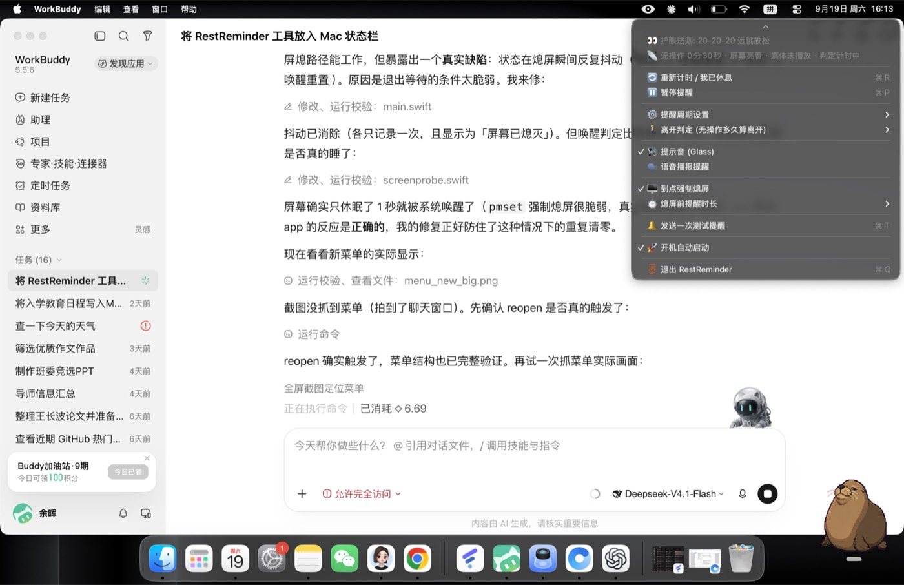
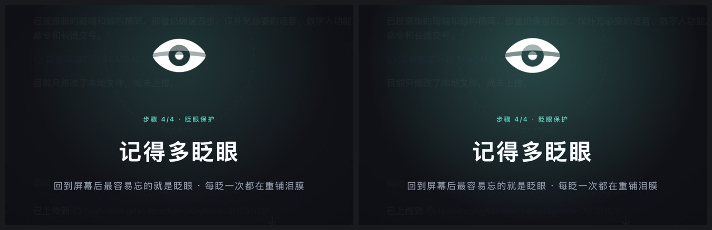
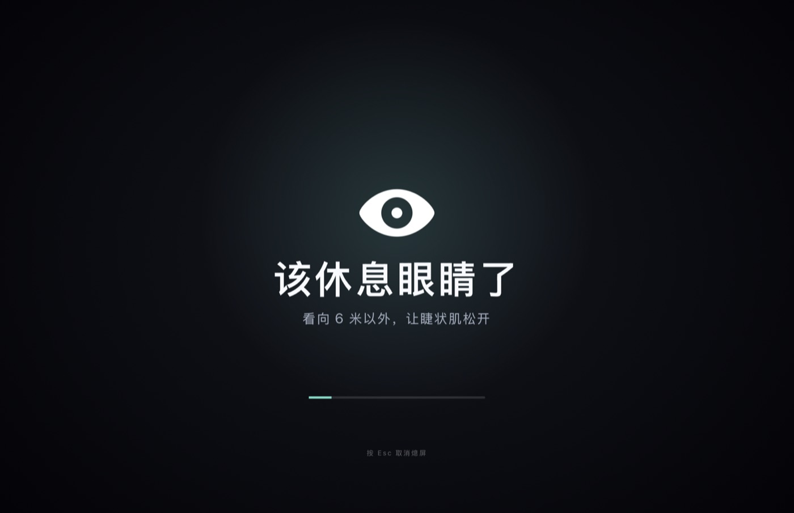
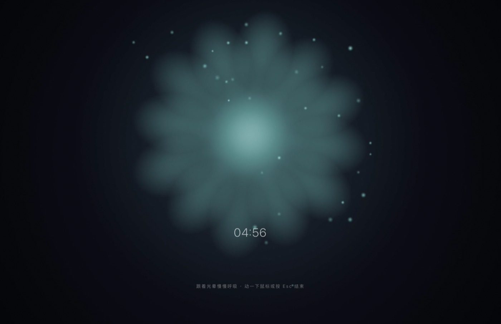
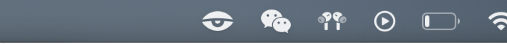
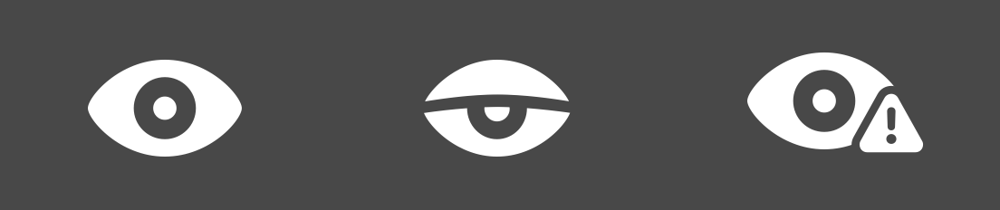

# RestReminder · 专为干眼症患者打造的休息提醒工具

> 一个常驻 macOS 菜单栏的护眼与休息提醒工具。它在**不打断你思路**的前提下，把「眨眼、远眺、起身」这三件事塞进你的日常节奏里，并把你每天的用眼情况做成一份可读的播报。

[](https://github.com/Zephyr-777/RestReminder)
[](https://swift.org)
[](LICENSE)
[](#)

🌐 **[官网 / 介绍页](https://zephyr-777.github.io/RestReminder/)** · 🍎 [English](README.en.md)



---

## 为什么做这个

市面上大多数护眼软件的做法是**弹一个窗口**，你点「稍后提醒」，然后它继续弹。

问题出在频率上。一个每 15 分钟出现一次的东西，本质上是一天 30 多次强制中断；到第三天，它就从「提醒」变成了「噪音」——而人一旦开始下意识地关掉提醒，这套机制就彻底失效了。

所以这个工具的设计前提是：**提醒不应该占用注意力，只应该占用周边视觉。**

相应地，它做了三件不那么常见的事：

1. **主提醒通道是菜单栏那只眼睛**——它会眨、会随时间变暗，余光扫一眼就够，不需要你去读、去点。
2. **休息是「带着你走一遍动作」，而不是「告诉你该休息了」**——全屏遮罩只占 15 秒，四个步骤配动画节拍，跟着做就行。
3. **它把「你什么时候忘了休息」变成可见的数据**——每天一份播报，不评价，只呈现。

---

## 功能

### 🌱 微休息：每 15 分钟，15 秒，四步动作

不是提示，是引导。15 秒里屏幕会依次走四步，每步配图标与文字节拍：

| 步骤 | 时间 | 做什么 | 为什么 |
|---|---|---|---|
| 1 | 0 – 2.5s | **闭紧双眼 2 秒** | 上下睑缘完全贴合，机械泵压睑板腺分泌脂质 |
| 2 | 2.5 – 6s | **自然睁开，缓慢眨眼** | 脂质层铺开，完成一次完整的泪膜重涂 |
| 3 | 6s – 收尾前 4s | **看向 6 米以外** | 睫状肌从持续收缩中松开 |
| 4 | **最后 4 秒** | **记得多眨眼**（图标当场眨两下） | 从遮罩回到内容的那一刻，最容易忘的就是眨眼 |

第四步是刻意放在结尾的：前三步在「停下来」，最后这一步在「接回去」。如果放在开头，你正闭着眼，说了也白说。



> 时长可选 10 / 15 / 20 秒。收尾阶段固定占最后 4 秒，但起点不早于第 8 秒——否则把时长调到 10 秒时，「远眺」会被挤成 0.5 秒，等于没有。

### ☕️ 大休息：每 45 分钟，进入一段呼吸画面

到点后播放一段全屏呼吸动画（可选 5 / 8 / 15 秒），接着落进一段**无缝循环的呼吸光晕**，或者干脆让显示器真熄屏。它想解决的是「你以为自己只坐了一小时，其实坐了四小时」。



循环画面不是随便录的一段视频——它按呼吸节律逐帧渲染：花瓣、光晕、粒子各自的周期都对到 15 秒循环点，播完一圈能无缝接上。渲染思路见 [`docs/design/`](docs/design/)。



**不等倒计时也能休息。** 菜单第一项「☕️ 立即大休」（`⌘B`）会跳过 45 分钟的等待，立刻走一遍同样的流程——提醒动画 → 循环休息画面 / 熄屏，并且按真实休息记账。

三个细节：

- 标题里直接写着这一休有多长（跟随「休息时长」设置），不用点进子菜单确认。
- 熄屏与否仍然尊重「到点强制熄屏」那个开关。在开会、演示的人点这一项，是想要休息提醒，不是想要黑屏。
- 如果循环画面用不了（影片缺失且没开强制熄屏），动画播完就收尾，把大休 / 微休计时清零并恢复计时——不会卡在「提醒中」。

### 😌 眨眼节律：每 5 分钟，只动一下眼睛

这是整套机制里频率最高的一档（一小时 12 次），所以它**不弹窗、不出声、不遮挡**，只做两件事：

- **菜单栏那只眼睛眨一下**：睁 → 半闭变暗 → 睁开，0.8 秒。看到「眼睛闭上」会诱发镜像性眨眼反射，比读一行「请眨眼」快得多。
- **图标在两次之间缓缓变干**：最后 30% 的时间里从全亮降到 60%。图标本身就是进度条——余光看到它有点灰了，顺手眨一下就恢复，**不需要任何东西来提醒你**。

还有一层可选的强度：**屏幕边缘极淡的青色呼吸**（默认关闭）。这里踩过一个坑，值得写下来：最初用白色做「提亮」，结果在白色网页上完全隐形（纯白叠 5% 白还是纯白），改成主色淡青后才在浅色、深色背景上都成立。

### 📊 每日用眼播报

App 每秒记一笔「这一秒在干什么」，按天落盘；播报脚本把这些原始数据渲染成一份单文件 HTML（无外链、可离线打开）：

- **屏幕使用时间**：4 个 KPI + 24 小时用眼强度柱图（悬停看每小时明细）
- **休息时间**：一天时间构成的环形图 + 微休/大休双轨达成率
- **用眼状态**：眼疲劳风险指数仪表盘（总时长 30 / 最长连续 25 / 休息缺口 25 / 夜间 20 加权）+ 14 天趋势 + 今日 vs 近 7 天日均对比

如果给了「完全磁盘访问权限」，它还会顺带读 Apple 自己的屏幕使用时间（`knowledgeC.db`），并排展示**系统口径**与**本工具口径**的分应用明细。两个数字差得多的那天，通常就是「盯着屏幕但手没动」——看视频、开会、读长文档都会这样。

### 👁 状态栏即仪表盘

它就住在右上角那一片图标里，不占 Dock：





| 状态 | 图标 | 含义 |
|---|---|---|
| 专注中 | `eye.fill` | 正在活跃计时 |
| 微休中 | `eye.circle.fill` | 正在做 15 秒泪膜重涂 |
| 离开中 | `eye.half.closed.fill` | 检测到人不在，暂停走表 |
| 大休到点 | `eye.trianglebadge.exclamationmark.fill` | 该起身了 |

### 🚶 在场判定

「人不在」不能只看键盘鼠标——看视频、开会、读长文档时手都是不动的。所以它同时看四条信号：

- 屏幕是否熄灭（`CGDisplayIsAsleep`）
- 屏幕是否锁定 / 是否在当前控制台（`CGSessionCopyCurrentDictionary`）
- 是否有进程持有**显示器睡眠断言**（说明有视频 / 演示 / 会议在全屏播放 → 仍算用眼）
- 键鼠无输入时长（默认 5 分钟算离开，可选 3 / 5 / 8 / 10）

判定为离开时计时冻结，回来接着算——而不是把离开的那半小时也算成「你盯了半小时屏幕」。

---

## 快速开始

### 环境要求

- macOS 13 (Ventura) 及以上
- **Apple Silicon**（`build.sh` 的编译目标是 `arm64-apple-macosx13.0`；Intel 机器请把 `-target` 改成 `x86_64-apple-macosx13.0`）
- Xcode Command Line Tools：`xcode-select --install`

没有 Xcode 工程、没有 SwiftPM、没有第三方依赖。`build.sh` 的核心就是一行 `swiftc`。

### 安装

```bash
git clone https://github.com/Zephyr-777/RestReminder.git
cd RestReminder
./install.sh
```

`install.sh` 会做六件事：编译 → 停掉旧实例 → 装进 `~/Applications` → 装播报脚本 → ad-hoc 签名并注册 → 启动。

装完菜单栏右上角会出现一只眼睛。**首次启动如果被 Gatekeeper 拦下**（没有公证签名），去「系统设置 → 隐私与安全性」点「仍要打开」，或者：

```bash
xattr -dr com.apple.quarantine ~/Applications/RestReminder.app
```

### 卸载

```bash
killall RestReminder
rm -rf ~/Applications/RestReminder.app
rm -f  ~/Library/LaunchAgents/com.zephyr777.restreminder.plist   # 如果开过开机自启
rm -rf ~/Library/Application\ Support/RestReminder               # 含历史统计，删前想清楚
rm -rf ~/Library/Logs/RestReminder
```

---

## 菜单一览

| 分组 | 内容 |
|---|---|
| 状态 | 当前在场判定、距离下次微休 / 大休倒计时、一行护眼法则 |
| 立即大休 | 快捷键 `⌘B` —— 不等倒计时，马上走一遍完整的大休息 |
| 重新计时 / 暂停 | 快捷键 `⌘R` / `⌘P` |
| 🌱 微休息设置 | 开关、触发间隔（10 / 15 / 20 分钟）、休息时长（10 / 15 / 20 秒）、预览动画 |
| ☕️ 大休息设置 | 开关、提醒周期（40 / 45 / 50 分钟）、倒计时时长、熄屏前提醒时长、强制熄屏、循环画面、预览完整流程 |
| 👁️ 眨眼节律 | 开关、间隔（3 / 5 / 10 / 20 分钟）、边缘光晕、演示一次 |
| 🚶 离开判定 | 3 / 5 / 8 / 10 分钟无操作算离开 |
| 📊 用眼报告 | 今日摘要 + 打开今日 / 昨日报告 + 打开报告文件夹 |
| 🔔 其他 | 提示音、语音播报、测试提醒、开机自启、退出 |

---

## 用眼统计与每日播报

### 数据在哪

```
~/Library/Application Support/RestReminder/
├── stats/YYYY-MM-DD.json          每秒记账的原始数据
├── screentime/YYYY-MM-DD.json     从 knowledgeC.db 读出的 Apple 屏幕使用时间（可选）
├── reports/YYYY-MM-DD.html        生成的播报
└── tools/                         由 install.sh 安装的 Python 脚本
~/Library/Logs/RestReminder/debug.log
```

`stats/*.json` **只存原始累积量**（秒数、次数、24 个小时桶），达成率、风险指数这类派生指标全留给播报脚本算——以后想换口径，不用改 app 也不用重装。

### 命令行用法

```bash
python3 ~/Library/Application\ Support/RestReminder/tools/daily_report.py              # 今天
python3 ~/Library/Application\ Support/RestReminder/tools/daily_report.py --date 2026-10-18
python3 ~/Library/Application\ Support/RestReminder/tools/daily_report.py --days 30    # 趋势窗口
```

菜单里也能直接点「打开今日报告」（`⌘D`），后台生成后用默认浏览器打开。

### 关于 Apple 的屏幕使用时间

```bash
python3 tools/screentime.py --diagnose   # 看有哪些数据流 / 验证权限
python3 tools/screentime.py --days 30    # 导出最近 30 天
```

数据从 `~/Library/Application Support/Knowledge/knowledgeC.db` 只读读取，需要给宿主程序（终端 / iTerm / 你用的编辑器）**完全磁盘访问权限**。没授权时播报里会显示一条提示，其余部分照常生成。

两个实现上的坑，写在这儿省得别人再踩：

- **`cp` / `shutil.copy2` 会被 TCC 拦住**（走的是 `copyfile(3)`），但 Python 自己的 `open()` 是允许的。所以脚本先尝试只读直连原库，被写锁挡住才退回逐块拷贝——而不是一上来就复制文件。
- **时间戳必须立刻转本地时区**：`ZSTARTDATE` 是 Cocoa 纪元的 UTC 秒数，直接取 `.hour` 做 24 小时分桶会整体偏 8 小时，图表会全挤在凌晨。

---

## 数据与隐私

- **全部本地处理**：不发起任何网络请求，没有账号，没有遥测，没有崩溃上报。
- 统计文件是明文 JSON，放在你自己的 `~/Library` 下，随时可查看、可删除。
- 读 Apple 屏幕使用时间是**可选**功能，不授权也能用，只是少了分应用明细。
- **iPhone / iPad 的屏幕使用时间拿不到**，不是没做，是做不到：跨设备数据走 CloudKit 私有容器，本机不落任何文件，Apple 也没有开放对应 API（`DeviceActivity` / `FamilyControls` 只给「管理自己 App 用量」的场景）。只有一个系统界面能看。

---

## 项目结构

```
Sources/
  main.swift              入口，含调试 flag 检测
  AppDelegate.swift       主逻辑：菜单、计时、状态栏、休息调度、自启
  Config.swift            配置键、@propertyWrapper 设置项、视觉样式常量
  Paths.swift             运行时目录约定（全部落在 ~/Library）
  Presence.swift          在场判定：熄屏 / 锁屏 / 媒体播放 / 无输入
  Stats.swift             每秒记账并落盘
  BlinkReminder.swift     眨眼节律：菜单栏动画、图标渐干、边缘光晕
  MicroBreakOverlay.swift 微休息全屏指引（四步动作节拍）
  BreakOverlay.swift      大休息全屏提醒 + 循环休息画面
  OverlayWindow.swift     遮罩窗口基类（层级 / 鼠标穿透 / 多屏）
  Logging.swift           带轮转的调试日志
tools/
  daily_report.py         播报生成器（读统计 → Material 风格单文件 HTML）
  screentime.py           Apple 屏幕使用时间读取器（knowledgeC.db）
assets/
  rest-loop.mp4           15 秒无缝循环的呼吸画面
  render-breath.swift     该画面的逐帧渲染脚本（Core Graphics）
docs/
  index.html              官网介绍页（GitHub Pages 从这里发布）
  design/                 循环画面、呼吸着色器与实现笔记
  images/                 README 用图
```

---

## 开发

```bash
./build.sh    # 只编译，产出 ./RestReminder.app
./install.sh  # 编译 + 安装 + 重启
```

改完代码后要走 `install.sh`：只 `build.sh` 的话，`~/Applications` 里跑的还是旧二进制。

源码里留了几个调试入口，启动前在 `/tmp` 放标记文件即可触发，不用重新点菜单：

```bash
touch /tmp/rr_preview_micro.flag   # 预览 15 秒微休息
touch /tmp/rr_preview.flag         # 预览大休息完整流程（含循环画面）
touch /tmp/rr_preview_blink.flag   # 演示一次眨眼
touch /tmp/rr_preview_halo.flag    # 单独看边缘光晕
touch /tmp/rr_preview_report.flag  # 生成并打开今日播报
touch /tmp/rr_preview_menu.flag    # 打开菜单并停留 2.5 秒（用于截图）
```

日志会轮转（超过 512 KB 保留最近 2000 行），不会无限增长：

```bash
tail -f ~/Library/Logs/RestReminder/debug.log
```

---

## 已知限制

- **仅 Apple Silicon**：`build.sh` 的编译目标写死为 `arm64`，Intel 需要自己改 `-target`。
- **没有代码签名与公证**：ad-hoc 签名，换机器或换版本后可能需要重新授权「完全磁盘访问权限」。
- **跨设备屏幕使用时间不可得**：见上文，Apple 未开放 API。
- **「真熄屏」依赖系统私有路径**（`CGDisplayForceToSleep` 系），未来系统版本可能失效；失效时请改用循环画面模式。

---

## License

[MIT](LICENSE) © 2026 Zephyr
